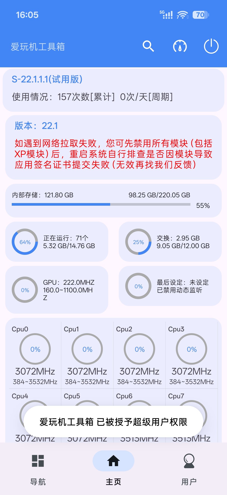
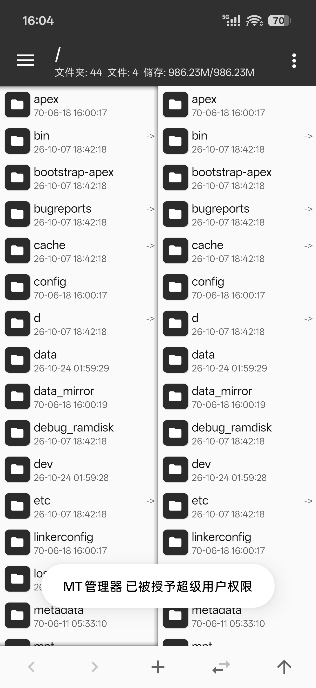
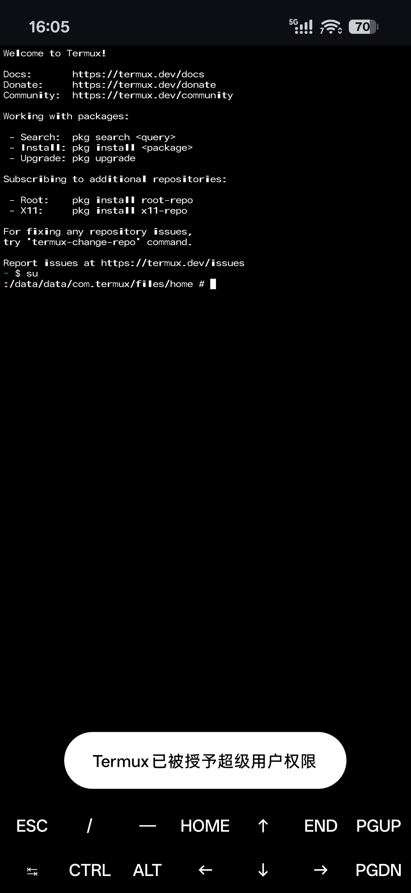

# KernelSU Grant Toast

[简体中文](https://github.com/NativeStar/KernelSUGrantToast/blob/master/README_zh.md)
[English](https://github.com/NativeStar/KernelSUGrantToast/blob/master/README.md)
[Русский](https://github.com/NativeStar/KernelSUGrantToast/blob/master/README_ru.md)

  <a href="/README.md">English</a> | 
  <a href="/README_zh.md">简体中文</a> | 
  <b>Русский</b>

##### Сделайте так, чтобы KernelSU показывал всплывающее уведомление «Предоставлены права Суперпользователя» (как в Magisk).

### Скриншоты

### Возможности

- Отображает всплывающее уведомление (тост), когда приложение получает повышенные привилегии.
- Поддерживает настройку текста уведомления.
- Поддерживает игнорирование уведомлений о предоставлении прав для указанных приложений.

### Установка

Скачайте пакет модуля со страницы релизов (Releases), затем выберите и установите его в KernelSU.

После установки перезагрузите устройство, чтобы модуль вступил в силу.

Этот модуль не зависит от Zygisk или MetaModule.

### Примечания по совместимости

Этот модуль предназначен только для последних версий KernelSU, поддерживающих логирование Su, и тестировался только с официальным релизом.

Совместимость с другими форками неизвестна. Теоретически он должен работать, если их реализация логирования Su не была изменена.

### Как это работает

Когда логирование Su включено, KernelSU запускает постоянный процесс, который получает данные логов, пересылаемые ядром, и записывает их в файл.

Эти данные поступают в реальном времени, что делает их идеальными для мониторинга событий.

После установки модуля и завершения загрузки устройства модуль завершает работу оригинального процесса, отвечающего за запись логов. Затем он получает файловый дескриптор, используемый для приема соответствующих данных (этот дескриптор может удерживать только один процесс, поэтому оригинальный процесс должен быть остановлен), и берет обработку событий на себя.

Если обнаруживается, что Android-приложению предоставлен root-доступ, модуль получает информацию о приложении и отображает уведомление при выполнении настроенных условий.

### Важные примечания

Поскольку процесс, изначально записывающий файл логов, завершается после загрузки устройства, логи Su больше не будут записываться.

Чтобы предотвратить накопление файлов, модуль также удаляет старые файлы логов после своего запуска.

В результате вы больше не сможете просматривать данные логов Su в менеджерe.

(Теоретически, можно было бы оставить оригинальный процесс запущенным и получать информацию путем отслеживания изменений в файле логов, но это может негативно отразиться на производительности.)

### Заключение

Этот модуль создан в основном ради развлечения.

Спасибо за использование!
